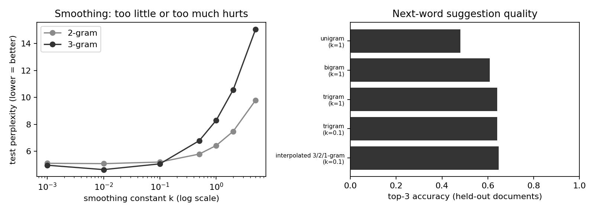

# Smart Keyboard V1

A small Streamlit app that suggests the next word with an n-gram language model. The project compares unigram, bigram, trigram, interpolation, and hard back-off models.

## Data and limitations

The corpus is synthetic, generated from a fixed-seed grammar. Its language is much more regular than real English, so perplexities are low. It has semantic groups (animals, foods, people, places, and objects) and part-of-speech tags for the related lab; `watch` is intentionally ambiguous as a noun and a verb. The current language model uses the sentence text and does not use the tags. The corpus is safe to share. When run locally, the app processes typed text on your computer. The deployed Streamlit Community Cloud app processes typed text on Streamlit's servers, so do not enter private text there.

## Run locally

Python 3.10 or newer is recommended.

### Windows PowerShell

```powershell
python -m venv .venv
.\.venv\Scripts\Activate.ps1
python -m pip install -r requirements.txt
python data/make_data.py
python -m src.evaluate
streamlit run app.py
```

### macOS or Linux

```bash
python3 -m venv .venv
source .venv/bin/activate
python -m pip install -r requirements.txt
python data/make_data.py
python -m src.evaluate
streamlit run app.py
```

The evaluation prints its results and writes `results/metrics.json`, `results/failures.txt`, and `results/ngram_results.png`.

## Results included

The provided split contains 960 training sentences and 240 test sentences, split by document. In the main comparison, the trigram with add-k smoothing (`k=0.1`) has perplexity 5.06 and top-3 accuracy 64.1%. The interpolated model has top-3 accuracy 64.7%. An unsmoothed trigram has infinite perplexity because 4.6% of test tokens receive probability zero.

The exploratory sweep reports a trigram perplexity of 4.63 at `k=0.01`. The lab uses the test set for this sweep as a teaching simplification; a separate validation set should be used for model tuning in a real evaluation.



## Failure analysis

- At the sentence start, the context `the` can precede many nouns. Only three suggestions are shown, so a valid noun such as `foxes` can be omitted. A larger suggestion list or a model that uses more context could help.
- The context `lazy soup` is absent from training. A trigram then has little evidence for the next word. Back-off to a bigram or unigram helps provide a suggestion, though it may be less specific.
- For `the foxes eat the`, the model may suggest `bread`, `apples`, or `soup` and miss `cakes`. These choices are all plausible under the small corpus; n-gram counts do not represent meaning. A larger, more varied corpus or semantic model would help.

## Deploy on Streamlit Community Cloud

1. Use the existing repository: [abderahim-freecoss/smart-keyboard-v1-SDIA](https://github.com/abderahim-freecoss/smart-keyboard-v1-SDIA).
2. In Streamlit Community Cloud, create an app from that repository, select the `main` branch and `app.py` as the main file, then deploy.
3. Open the deployed app and copy its public app URL.
4. Submit that app URL and the GitHub repository URL in Classroom.

The app has no secrets or credentials. Keep the repository root as the app folder so Streamlit can find `requirements.txt`, `app.py`, and `data/corpus.csv`.
